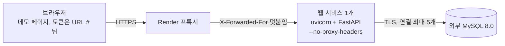

# 배포 (7단계: 준비 완료, 실제 배포는 보류)

저장소에 있는 것: `render.yaml`(Render Blueprint), 배포용 설정(TLS, 연결 풀, 빈도 제한, 프록시 수), CI의 서버 기동 스모크 테스트.
한 것: 공개 저장소 github.com/hocastle1999/group-settlement에 push, GitHub CI 통과(MySQL 8.0 테스트, `alembic check`, 스모크 테스트).
아직 하지 않은 것: MySQL 만들기, Render 서비스 만들기. 모두 사용자 계정과 결정이 필요하다.

## 구성

- 웹 서비스는 **하나**다. 빈도 제한이 서버 메모리에 있어서 여러 대면 각자 센다. 원장 정합성은 DB(그룹 행 잠금, 제약)가 지키므로 여러 대여도 깨지지 않는다.
- 시작 명령이 마이그레이션(`alembic upgrade head`)을 먼저 돌린다. 인스턴스가 하나라 두 프로세스가 동시에 마이그레이션할 일이 없다.

## MySQL은 어디에

Render는 관리형 MySQL을 제공하지 않는다(PostgreSQL만). 후보:

| 후보 | 장점 | 주의 |
| --- | --- | --- |
| **관리형 MySQL 8.0 (예: Aiven for MySQL 무료 플랜)** (추천) | 진짜 MySQL 8.0이라 로컬·CI와 같다. TLS 기본 | 무료 조건(용량, 연결 수, 휴면)은 가입할 때 확인. 지역을 싱가포르 근처로 |
| TiDB Cloud Serverless | MySQL 호환, 무료 용량이 넉넉한 편 | **CHECK 제약이 기본으로 꺼져 있다**(`tidb_enable_check_constraint`). 이 프로젝트는 CHECK를 마지막 방어선으로 쓰므로 켜지 않으면 조용히 빠진다. 잠금·격리 수준 동작도 MySQL과 다를 수 있어 동시성 테스트를 다시 돌려야 한다 |
| Render 비공개 서비스 + 디스크에 MySQL 컨테이너 | 한 곳에서 관리 | 디스크는 유료. 백업·업그레이드를 직접 해야 한다 |
| 집 PC의 MySQL을 인터넷에 노출 | 무료 | 하지 않는다. 보안 위험, PC가 꺼지면 서비스도 멈춘다 |

조건: MySQL **8.0.16 이상**(CHECK 제약을 실제로 검사하는 버전), 윈도 함수와 CTE(리포트), `utf8mb4`.

## 사용자가 할 일 (순서)

1. ~~GitHub 저장소 만들기와 push~~ — 완료(공개 저장소, CI 통과). 이후 push는 먼저 묻는다.
2. **MySQL 만들기**
   - DB `group_settlement`(utf8mb4), 앱 전용 사용자(그 DB 권한만). 관리자 계정을 앱에 쓰지 않는다.
   - 접속 정보(호스트, 포트, 사용자, 비밀번호)는 Render 대시보드에만 넣는다. 저장소, 문서, 채팅에 남기지 않는다.
3. **Render 서비스 만들기**
   - **이 프로젝트 전용 워크스페이스**에서 한다. 기존 워크스페이스에는 24시간 도는 다른 무료 서비스가 있어 무료 사용 시간을 함께 쓰면 둘 다 멈출 수 있다(smart-elevator와 같은 이유).
   - New → Blueprint → 저장소 선택 → `render.yaml`이 읽힌다. `sync: false`인 `DB_HOST`, `DB_PORT`, `DB_NAME`, `DB_USER`, `DB_PASSWORD`를 입력한다.
4. **배포 뒤 확인**
   - [ ] `/health`가 `{"status":"ok"}`
   - [ ] 로그에 `Running upgrade ... -> c3f995ee41a8`(또는 최신 revision)가 있고 서버가 떴다
   - [ ] 데모 페이지에서 그룹 만들기 → 멤버 → 지출(외화 포함) → 정산 확정 → 송금 완료 → 리포트 → 감사 로그 검증 "이상 없음"
   - [ ] 그룹 만들기를 11번 해서 429가 나는지. **이때의 기준 IP가 내 공인 IP인지**(프록시 IP면 모든 방문자가 한도 하나를 같이 쓴다) → 아니면 `TRUSTED_PROXY_HOPS`를 조정
   - [ ] Render 접근 로그의 요청 경로에 초대 토큰이 없는지(`#` 뒤는 전송되지 않는다)

## 환경 변수 (Render)

| 키 | 값 | 이유 |
| --- | --- | --- |
| `DB_HOST`, `DB_PORT`, `DB_NAME`, `DB_USER`, `DB_PASSWORD` | 대시보드에서 입력 | 비밀 정보는 저장소에 두지 않는다 |
| `DB_SSL` | `true` | 외부 DB는 TLS. 서버 인증서와 호스트 이름을 검증한다 |
| `DB_POOL_SIZE`, `DB_MAX_OVERFLOW` | `3`, `2` | 무료 DB의 작은 연결 한도 (최대 5개) |
| `TRUSTED_PROXY_HOPS` | `1` | Render 앞단 프록시 1개. X-Forwarded-For를 오른쪽에서 1개 센 값이 접속자 |
| `SETTLE_OPTIMAL_LIMIT` | `14` | 무료 인스턴스 CPU가 느리다. 14명이면 로컬 8ms |
| `RATE_LIMIT_GROUPS_PER_HOUR`, `RATE_LIMIT_WRITES_PER_MINUTE` | 기본값 10, 60 | 필요하면 대시보드에서 바꾼다 |

## 운영 메모

- **uvicorn은 `--no-proxy-headers`로 띄운다.** 기본값은 127.0.0.1에서 온 요청의 `X-Forwarded-For`를 믿고 접속자 IP를 바꿔 넣는다. 로컬에서 이 기본값으로 띄웠더니 헤더 위조로 빈도 제한이 풀렸다(docs/troubleshooting.md). IP 해석은 앱이 `TRUSTED_PROXY_HOPS`로 한다.
- **마이그레이션 실패**: 시작 명령이 멈추고 서버가 뜨지 않는다. MySQL DDL은 롤백되지 않으므로 반쯤 적용된 상태일 수 있다. 로그를 보고 `alembic current`와 실제 테이블을 먼저 확인한다.
- **무료 인스턴스는 한동안 요청이 없으면 잠든다.** 첫 요청이 느리다. 데모 용도라 그대로 둔다.
- **계속 쌓이는 데이터**: 멱등성 키와 감사 로그는 지우지 않는다. 멱등성 키는 보관 기간(예: 24시간)을 정해 지우는 작업을, 감사 로그는 오래된 구간을 보관소로 옮기는 작업을 사용량을 보고 추가한다(감사 로그를 지우면 해시 체인 기준점도 함께 옮겨야 한다).
- **백업**: DB 호스트의 백업 기능을 켠다. 원장은 추가만 하므로 시점 복구(PITR)가 가장 잘 맞는다.
- **다음 강화 후보**: 마이그레이션 계정과 앱 계정을 나누고 앱 계정에서 원장 테이블의 UPDATE/DELETE 권한을 회수(append-only를 DB 권한으로), 감사 로그 기준점 hash를 DB 밖에 주기적으로 남기기.
