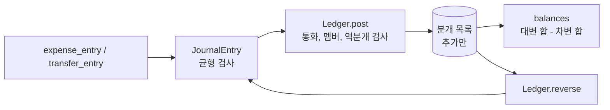
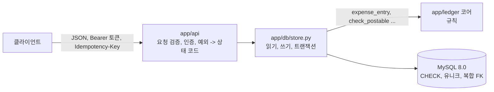
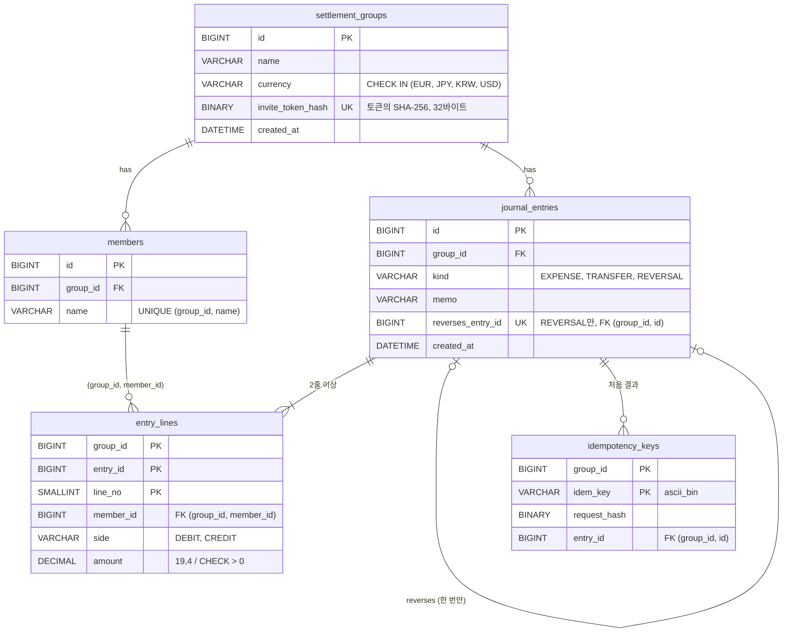
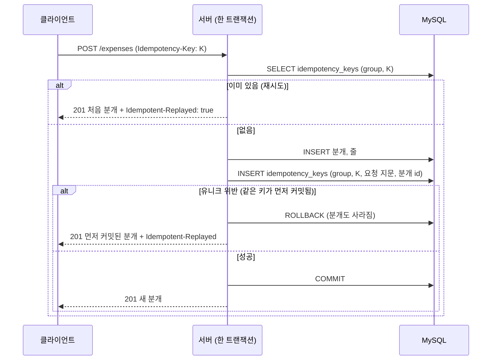
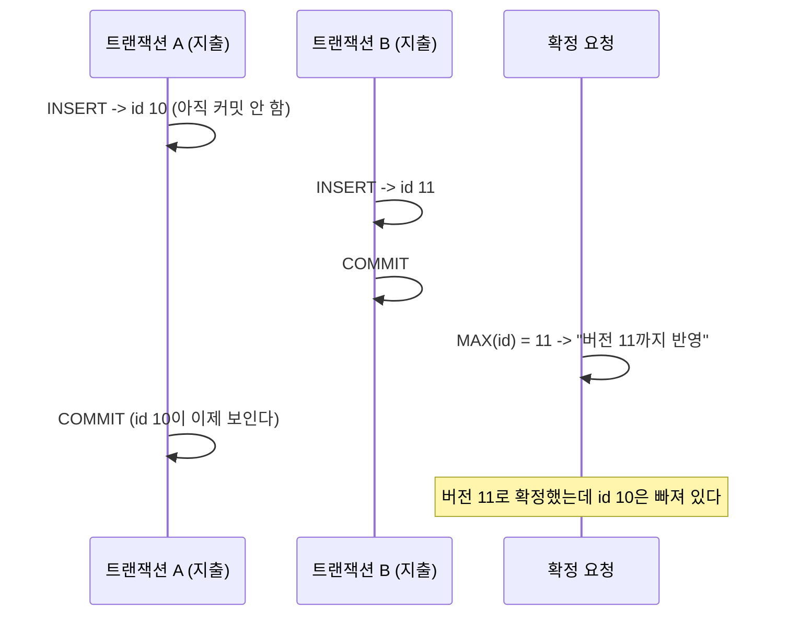
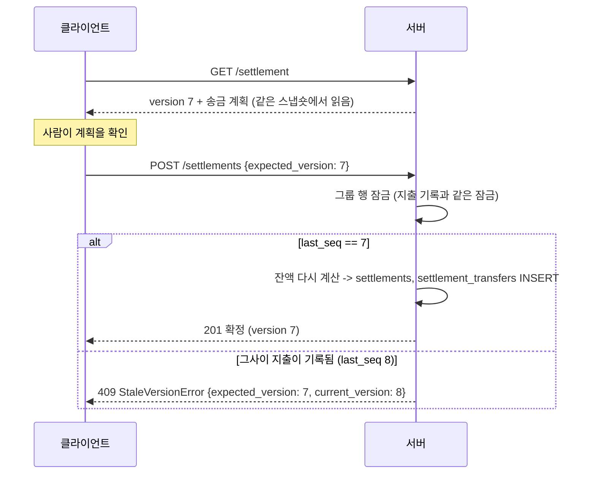
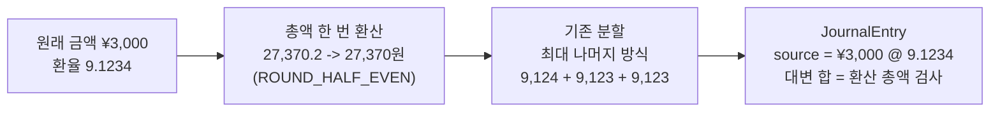

# 설계

## 1단계: 금액·원장 코어 (`app/ledger/`)

DB, 웹, 시계, 난수 없이 표준 라이브러리만 쓰는 순수 파이썬이다. 같은 입력이면 항상 같은 결과가 나온다.
3단계 이후의 DB와 API는 여기서 정한 규칙을 그대로 옮긴다.

### 금액: `Money` (`money.py`)

- `Decimal` 금액 + `Currency`(코드, 소수 자릿수). 불변 값 객체다.
- **float를 받지 않는다.** `Decimal(0.1)`은 `0.1000000000000000055...`이다. 오차가 들어온 뒤에는 되돌릴 수 없으므로 입구에서 막는다.
- **통화 단위보다 작은 값을 만들 수 없다.** 1.5원, 0.001달러는 `InvalidAmountError`. 반올림을 몰래 하지 않는다.
- 다른 통화끼리 더하거나 비교하면 `CurrencyMismatchError`.

다른 방법과 비교:

| 방법 | 장점 | 단점 |
| --- | --- | --- |
| float | 간단 | 이진 오차. 돈에는 쓰면 안 된다 |
| 최소 단위 정수(센트, 원)만 저장 | 빠르고 정확 | 통화마다 자릿수를 따로 기억해야 하고 읽기 어렵다 |
| **Decimal + 통화 자릿수 검증 (선택)** | 정확, 읽기 쉬움, MySQL `DECIMAL`과 그대로 대응 | 정수보다 느리다 (정산 규모에서는 문제없음) |

나누기처럼 내부에서 정수가 편한 계산은 `minor_units`(최소 단위 정수)로 바꿔서 한다.

### 분할: `split.py`

`SplitRule`의 `shares(total) -> {멤버: 금액}`. 결과의 합은 반드시 `total`과 같다.

- `EqualSplit`: 균등
- `RatioSplit`: 정수 비율 (2:1:1, 50:30:20). 가중치 0이면 부담하지 않음
- `FixedSplit`: 직접 입력. 합이 총액과 다르면 거부한다 (차액을 누군가에게 몰래 얹지 않는다)

**나머지 배분: 최대 나머지 방식 (largest remainder)**

1. 최소 단위 정수로 각자 몫을 내림한다: `q, r = divmod(units * w, weight_sum)`
2. 남은 단위를 나머지 `r`이 큰 사람부터 1단위씩 준다.
3. `r`이 같으면 멤버 ID 순서. 입력 순서에 따라 결과가 바뀌지 않게 하려고(결정성).

`r`(정수)로 비교하므로 소수 계산 오차가 없다. 이 방식은 각자의 몫이 정확한 비율 값의 내림 또는 올림이 됨을 보장한다(테스트로 확인).

다른 방법: 남은 1원을 항상 결제자에게, 또는 항상 첫 사람에게 줄 수도 있다. 간단하지만 비율 분할에서 정확한 비율과 더 멀어질 수 있다.

### 원장: `ledger.py`

**이중기입.** 분개(`JournalEntry`)는 차변(`DEBIT`)과 대변(`CREDIT`) 줄로 이루어지고 두 합계가 같아야만 만들어진다.
멤버마다 계정이 하나 있고, 잔액 = 대변 합 - 차변 합이다.

| 거래 | 대변 (받을 돈 +) | 차변 (받을 돈 -) |
| --- | --- | --- |
| A가 30,000원을 내고 A, B, C 균등 | A 30,000 | A 10,000, B 10,000, C 10,000 |
| B가 A에게 10,000원 송금 | B 10,000 | A 10,000 |

모든 분개가 균형이므로 **모든 멤버 잔액의 합은 항상 0**이다. 이 값이 0이 아니면 버그다.



줄 표현: 부호 있는 금액 하나(+대변, -차변)로도 되지만, 금액은 항상 양수로 두고 방향을 `side`로 분리했다.
DB에서 `CHECK (amount > 0)`로 잘못된 값을 막을 수 있고, 회계 용어와 그대로 대응한다.

**추가만 한다 (append-only).** 잘못 기록한 분개는 고치거나 지우지 않고 역분개(`REVERSAL`)를 추가한다.

- 역분개는 원래 분개의 줄을 정확히 뒤집은 것이어야 한다. 아니면 거부한다.
- 한 분개는 한 번만 취소할 수 있고, 역분개 자체는 취소할 수 없다. 다시 필요하면 원래 거래를 새로 기록한다.
- 검사에 실패하면 원장은 바뀌지 않는다.

잔액은 매번 모든 분개를 다시 더해서 구한다. 잔액을 따로 저장하는 방식과의 비교는 4단계에서 했고, 커버링 인덱스 + SUM을 유지하기로 했다([실험](experiments.md#4단계-잔액-계산-방식과-동시성)).

### 테스트 (1단계)

- 예시 기반 테스트: 대표 사례와 오류 경로
- property-based 테스트(`hypothesis`): 무작위 입력에서 불변식이 지켜지는지
  - 분할 결과의 합 = 총액, 각자 몫은 정확한 값의 내림 또는 올림, 입력 순서와 무관
  - 무작위 거래·송금·취소 순서 뒤에도 잔액 합 = 0, 모든 분개가 균형
  - 모든 분개를 취소하면 모든 잔액이 0
- CI(`CI` 환경 변수)에서는 hypothesis 시드를 고정한다(`derandomize`). 같은 커밋이면 같은 결과.

## 2단계: 최소 송금 (`app/ledger/settle.py`)

입력은 원장 잔액(합 0), 출력은 `Transfer(sender, receiver, amount)` 목록이다. 송금을 모두 반영하면 모든 잔액이 0이 된다.
금액의 총합은 방법과 상관없이 같으므로, 줄일 수 있는 것은 **송금 횟수**다.

### 그리디 (`greedy_transfers`)

가장 많이 받을 사람과 가장 많이 낼 사람을 짝지어 둘 중 작은 금액을 보낸다. 힙 두 개, O(k log k).
한 번 보낼 때마다 적어도 한 명이 0이 되므로 최대 k - 1번이다(k = 잔액이 0이 아닌 사람 수).
금액이 같으면 멤버 ID 순서로 고른다(결정성).

최적이 아닐 수 있다. 잔액 `a:-3, b:+2, c:+3, d:+2, e:-4`에서
- 최적: {a, c}와 {b, d, e}로 나누면 1 + 2 = **3번**
- 그리디: 가장 큰 c(+3)와 e(-4)를 먼저 짝지어 두 묶음이 섞인다 → **4번**

### 최적 (`optimal_transfers`)

**관찰:** 사람들을 잔액 합이 0인 묶음 g개로 나눌 수 있으면, 묶음마다 (인원 - 1)번이면 되므로 총 k - g번이다.
반대로 어떤 송금 목록이든 송금으로 연결된 사람들끼리 묶으면 합이 0인 묶음이 된다. 그래서

> 최소 송금 수 = k - (합이 0인 묶음으로 나눌 수 있는 최대 개수)

이 문제는 부분집합 합 문제를 포함하는 NP-hard 문제라 다항 시간 해법은 기대하기 어렵다. 비트마스크 DP로 푼다.

- `sum[mask]`: mask에 속한 사람들의 잔액 합. 가장 낮은 비트를 뺀 mask에서 한 번에 구한다. O(2^k)
- `dp[mask] = max(dp[mask - {i}] for i in mask) + (sum[mask] == 0 ? 1 : 0)`
  - 사람을 한 명씩 추가하는 순서를 생각하면, 합이 0이 되는 시점마다 묶음 하나가 닫힌다. dp는 그 최대 횟수.
- 역추적으로 묶음을 복원한 뒤, **묶음 안에서는 그리디**로 송금을 만든다. 합이 0인 묶음 안에서 그리디는
  (인원 - 1)번 이하이므로 전체가 최솟값이 된다.
- 시간 O(2^k x k), 메모리 O(2^k).

### 선택: `settle(strategy=AUTO)`

잔액이 남은 사람이 16명 이하면 최적, 넘으면 그리디. 근거는 [experiments.md](experiments.md):
금액이 둥근 모임(1/N, 만 원 단위)에서는 그리디가 자주 1 ~ 2번 더 보내고, 16명까지는 최적이 37ms 안에 끝난다.

| 방법 | 송금 수 | 시간 | 쓰는 곳 |
| --- | --- | --- | --- |
| 그리디 | ≤ k - 1, 최적이 아닐 수 있음 | O(k log k) | 17명 이상 |
| 비트마스크 DP | 최소 | O(2^k x k) | 16명 이하 (기본) |

### 테스트 (2단계)

- 그리디가 최적이 아닌 최소 예시(위 5명)를 고정 테스트로 둔다.
- property: 두 방법 모두 모든 잔액을 0으로 만든다, 채무자만 보내고 채권자만 받는다, 최적 ≤ 그리디 ≤ k - 1,
  입력 순서와 결과가 무관하다.
- **DP 검증:** 8명 이하에서 DP와 독립적인 완전 탐색(합 0인 부분집합으로 나누는 모든 방법을 재귀로 시도)과 송금 수가 같은지 비교한다.

## 3단계: DB 스키마와 REST API

코어(`app/ledger`)는 그대로 두고 바깥에 두 층을 더했다.



- **규칙은 코어 한 곳에만 있다.** 저장 계층은 코어 함수로 `JournalEntry`를 만들고, 코어의 `check_postable`, `check_reversal`로 검사한 뒤 INSERT만 한다. 이 검사 함수는 원래 `Ledger.post` 안에 있던 것을 공개 함수로 꺼낸 것이라 메모리 원장과 DB가 같은 코드를 쓴다.
- **DB 제약은 마지막 방어선이다.** 코어를 거치지 않은 쓰기(직접 SQL, 미래의 다른 코드)나 동시 요청이 규칙을 깨지 못하게 막는다.

### 테이블 (ERD)



| 결정 | 이유 | 다른 방법 |
| --- | --- | --- |
| 테이블 이름 `settlement_groups` | `GROUPS`는 MySQL 8.0 예약어(윈도 함수 프레임) | 백틱으로 감싸기: 모든 SQL에서 빠뜨리기 쉽다 |
| `amount DECIMAL(19,4)` + `CHECK (amount > 0)` + `side` | 코어 `Line`과 같은 모양. 음수·0 금액을 DB가 거부한다. 소수 4자리는 5단계(소수 3자리 통화, 환산)를 위한 여유 | 부호 있는 금액 하나: CHECK로 "0이 아님"만 막고 방향 실수는 못 잡는다. FLOAT/DOUBLE: 0.1을 정확히 못 담는다 |
| `UNIQUE (reverses_entry_id)` | 한 분개는 한 번만 취소. 앱 검사와 INSERT 사이에 다른 요청이 끼어도 두 번째 INSERT가 실패한다. 유니크 인덱스는 NULL을 여러 개 허용하므로 일반 분개는 모두 NULL이어도 된다 | 앱 검사만: 동시 요청 두 개가 모두 "아직 취소 안 됨"을 보고 둘 다 기록할 수 있다 |
| `CHECK ((kind = 'REVERSAL') = (reverses_entry_id IS NOT NULL))` | 역분개만, 그리고 역분개는 반드시 대상을 가진다 (코어 `JournalEntry`와 같은 규칙) | |
| **복합 외래 키** `(group_id, member_id) -> members (group_id, id)` 등 | 줄과 멱등성 키에도 `group_id`를 두고 (그룹, id) 쌍을 참조한다. 다른 그룹의 멤버나 분개를 가리키는 행은 INSERT부터 실패한다 | 단순 FK `member_id -> members.id`: 존재만 확인하고 "같은 그룹인지"는 못 본다 |
| `entry_lines` 기본키 `(group_id, entry_id, line_no)` | InnoDB는 기본키 순서로 행을 저장한다. 한 그룹의 줄이 모여 있고, 앞부분 `(group_id, entry_id)`가 분개 FK의 인덱스가 된다 | 자동 증가 id: 인덱스가 하나 더 필요하다 |
| ENUM 대신 `VARCHAR + CHECK` | MySQL ENUM은 값 추가에 ALTER TABLE이 필요하고 정렬이 내부 순번 기준이다 | |
| `idem_key` 콜레이션 `ascii_bin` | 기본 콜레이션(`utf8mb4_0900_ai_ci`)은 대소문자를 무시해 `abc`와 `ABC`가 같은 키가 된다 | |
| 멤버 이름은 기본 콜레이션 | "Alice"와 "alice"를 같은 사람으로 본다(중복 등록 방지) | |

**append-only.** 앱은 원장 테이블에 UPDATE와 DELETE를 보내지 않는다. 취소는 역분개 INSERT다. `test_app_never_updates_or_deletes_ledger_rows`가 API 전체 흐름에서 나가는 SQL을 모두 가로채 확인한다.
DB 차원에서 강제하는 방법(트리거로 UPDATE/DELETE 거부, 앱 계정의 UPDATE/DELETE 권한 회수)도 있다. 지금은 마이그레이션과 앱이 같은 계정을 써서 권한을 나누지 않았다. 배포(7단계)에서 마이그레이션 계정과 앱 계정을 나눌 때 다시 본다.

**코어 멤버 ID.** 코어의 `MemberId`(문자열)는 DB 멤버 id를 `str()`로 바꾼 값이다. 분할에서 남는 단위는 "멤버 ID 순서"로 주므로 문자열 순서(`"10" < "9"`)를 따르지만, 같은 입력이면 같은 결과라는 결정성은 그대로다.
알려진 한계: 남는 1원은 늘 ID 순서가 앞선 멤버에게 간다. 지출이 많이 쌓이면 같은 사람이 몇 원씩 더 낸다 (docs/troubleshooting.md).

### 잔액: SQL SUM

```sql
SELECT m.id, COALESCE(SUM(CASE WHEN l.side = 'CREDIT' THEN l.amount ELSE -l.amount END), 0)
FROM members m
LEFT JOIN entry_lines l ON l.group_id = m.group_id AND l.member_id = m.id
WHERE m.group_id = ?
GROUP BY m.id
```

- LEFT JOIN이라 기록이 없는 멤버도 0으로 나온다.
- 결과를 `Money`로 바꾼 뒤 합이 0인지 확인한다. 0이 아니면 `UnbalancedBalancesError`(500). 원장이 깨진 것은 클라이언트 잘못이 아니다.
- 3단계 `EXPLAIN`(그룹 3개 x 분개 1,500개, 한 그룹 6,000줄): `entry_lines`는 `ix_entry_lines_group_id_member_id`로 멤버마다 조회, 약 5ms. `side`, `amount`는 기본키로 다시 읽었다(커버링 아님). 4단계에서 커버링 인덱스 `(group_id, member_id, side, amount)`로 바꿨다(`Using index`). 줄이 2개뿐일 때는 옵티마이저가 기본키 앞부분을 골랐다. 데이터가 적을 때의 EXPLAIN은 믿지 않는다.
- 커버링 인덱스, 잔액 테이블과의 비교는 4단계 "잔액 계산 방식".
- `test_sql_balances_match_in_memory_ledger`: 같은 무작위 거래(지출 3종, 송금, 취소 40번)를 DB와 메모리 `Ledger`에 넣고 매 단계 잔액이 같은지 비교한다.

### 인증: 초대 링크 토큰

회원가입 없이, 그룹을 만들 때 받은 토큰을 아는 사람이 그 그룹의 멤버다.

1. `POST /api/groups` -> 서버가 `secrets.token_urlsafe(32)`(256비트 무작위)를 만들어 **응답에 한 번만** 넣는다.
2. DB에는 토큰의 **SHA-256 해시**만 저장한다. DB가 유출돼도 해시로는 API를 호출할 수 없다.
3. 이후 요청은 `Authorization: Bearer <토큰>`. 서버는 `WHERE id = :group_id AND invite_token_hash = sha256(:token)`.

| 질문 | 답 |
| --- | --- |
| 왜 bcrypt/argon2가 아니라 SHA-256? | 느린 해시는 사람이 고른 약한 비밀번호의 사전 공격을 늦추려는 것이다. 토큰은 256비트 무작위라 대입이 불가능하다. 또 솔트를 넣으면 해시로 인덱스 조회를 할 수 없다 |
| 왜 URL이 아니라 헤더? | URL 경로와 쿼리는 접근 로그, 브라우저 기록, Referer 헤더에 남는다 |
| 왜 틀린 토큰에 403이 아니라 404? | 403이면 "이 id의 그룹은 있다"가 드러나, id를 늘려 가며 그룹 수를 셀 수 있다. 그룹이 없을 때와 같은 404, 같은 본문을 준다. 헤더가 아예 없으면 401(그룹과 무관한 응답) |
| 타이밍 공격은? | DB가 비교하는 값은 토큰이 아니라 해시다. 공격자가 해시의 앞부분을 한 바이트씩 맞춰 갈 수 없으므로 비교 시간 차이는 쓸모가 없다 |

**1번 프로젝트(reservation-api)의 JWT와 비교**

| | JWT (1번) | 초대 토큰 (3번) |
| --- | --- | --- |
| 무엇을 나타내나 | 사용자(계정) | 그룹 하나에 대한 접근 권한 |
| 서버 상태 | 없음(서명만 검증) | DB에 해시 저장 (요청마다 조회 1번) |
| 폐기 | 어렵다. 만료를 기다리거나 차단 목록이 필요 | 해시 행만 바꾸면 즉시 (토큰 재발급은 6단계 후보) |
| 만료 | 짧은 만료 + 리프레시 토큰 | 없음. 링크를 아는 한 계속 쓴다(모임 정산의 사용 방식) |
| 권한 단위 | 사용자 -> 여러 리소스 | 토큰 하나 = 그룹 하나 |
| 약점 | 탈취되면 만료까지 유효 | 링크가 퍼지면 누구나 접근. "누가 기록했는지"는 모른다 |

정산 앱은 "링크를 받은 사람끼리 쓰는" 도구라 계정 없는 토큰이 맞다. 사람별 권한이 필요해지면 계정이나 멤버별 토큰으로 바꿔야 한다.

### 멱등성: `Idempotency-Key`

지출 기록 요청을 보냈는데 응답 전에 네트워크가 끊기면 클라이언트는 다시 보낼 수밖에 없다. 그대로 처리하면 같은 지출이 두 번 기록된다.
분개를 만드는 쓰기(지출, 송금, 취소)는 `Idempotency-Key` 헤더가 **필수**다(없으면 400).



- **키와 분개를 같은 트랜잭션에 넣는다.** 키만 남고 분개가 없거나, 분개만 있고 키가 없는 상태가 생기지 않는다.
- **같은 키가 동시에 오면** 늦은 트랜잭션은 키 INSERT에서 InnoDB 잠금을 기다린다. 먼저 온 쪽이 커밋하면 유니크 위반 -> 롤백 -> 먼저 커밋된 결과를 돌려준다. 4개 스레드가 같은 키로 동시에 보내는 테스트에서 분개는 1개였다(10번 반복).
- 흔히 쓰는 "키를 PROCESSING으로 먼저 선점 -> 처리 -> 결과 UPDATE" 방식보다 단순하다. 상태가 없으니 "PROCESSING인 채로 죽은 키"를 정리할 필요도 없다. 대신 처리 전체가 하나의 DB 트랜잭션 안에 있어야 한다. 외부 결제 API 호출처럼 롤백할 수 없는 작업이 끼면 이 방법을 쓸 수 없다.
- **요청 지문**: `SHA-256(메서드 + 경로 + 검증된 본문을 키 정렬한 JSON)`. 같은 키에 다른 요청이면 422(IETF Idempotency-Key 초안의 권고). 필드 순서나 공백만 다르면 같은 요청이다. 경로가 들어가므로 같은 키를 지출과 송금에 쓰면 다른 요청이다.
- 키는 그룹마다 따로다(기본키 `(group_id, idem_key)`). 영문, 숫자, `-`, `_` 1 ~ 64자.
- 실패한 요청(422 등)은 키를 남기지 않는다. 고쳐서 같은 키로 다시 보낼 수 있다.
- 키를 지우지 않는다. 보관 기간(예: 24시간)과 정리 작업은 필요해지면 추가한다.

키를 받지 않는 쓰기:
- **멤버 추가**: 그룹 안에서 이름이 유일하다는 자연 키가 있다. 재시도하면 409.
- **그룹 생성**: 토큰 원문을 저장하지 않으므로 "처음 응답 다시 주기"로 같은 토큰을 돌려줄 수 없다. 재시도로 빈 그룹이 하나 더 생겨도 해가 없다.

### API

| 메서드 | 경로 | 설명 |
| --- | --- | --- |
| POST | `/api/groups` | 그룹 생성. 응답의 `invite_token`은 이때만 보인다 |
| GET | `/api/groups/{id}` | 그룹과 멤버 |
| POST | `/api/groups/{id}/members` | 멤버 추가 |
| POST | `/api/groups/{id}/expenses` | 지출. 5단계부터 `currency`, `fx_rate`(외화). `split`: `{"type": "equal", "member_ids"}`, `{"type": "ratio", "weights": [{member_id, weight}]}`, `{"type": "fixed", "amounts": [{member_id, amount}]}` |
| POST | `/api/groups/{id}/transfers` | 송금 |
| POST | `/api/groups/{id}/entries/{entry_id}/reversal` | 취소(역분개) |
| GET | `/api/groups/{id}/entries?limit&before_id` | 최신순 분개. 키셋 페이지네이션(`next_before_id`) |
| GET | `/api/groups/{id}/balances` | 멤버별 잔액 |
| GET | `/api/groups/{id}/settlement?strategy=auto` | 정산 송금 목록(계산만, 기록하지 않음). 4단계부터 원장 `version` 포함 |
| POST | `/api/groups/{id}/settlements` | 정산 확정 `{expected_version, strategy}`. 버전이 바뀌었으면 409 (4단계) |
| GET | `/api/groups/{id}/settlements`, `/settlements/{settlement_id}` | 확정 기록. `current_version`으로 확정 뒤 변화 여부 표시 (4단계) |

- 금액은 JSON **문자열**("12.34")로만 주고받는다. JSON 숫자는 대부분의 파서가 double로 읽어 서버에 오기 전에 오차가 생길 수 있으므로 거부한다(422).
- 요청 모델은 모르는 필드를 거부한다(`extra="forbid"`).
- `split`은 `type`으로 고르는 판별 유니온이다. 목록 형태라 같은 멤버가 두 번 오면 dict로 바꾸기 전에 거부한다(조용히 덮어쓰지 않게).
- 목록은 OFFSET이 아니라 키셋(`id < before_id`)이다. 뒤쪽 페이지도 인덱스에서 바로 시작하고, 그사이 새 분개가 생겨도 항목이 밀리지 않는다.
- 핸들러는 `def`다. PyMySQL은 블로킹이라 `async def`에서 부르면 이벤트 루프가 멈춘다. `def` 핸들러는 스레드 풀에서 돈다.

### 예외 -> HTTP 상태 코드 (`app/api/errors.py`)

| 예외 | 상태 | 뜻 |
| --- | --- | --- |
| `InvalidAmountError`, `InvalidSplitError`, `UnbalancedEntryError`, `CurrencyMismatchError`, `UnknownMemberError`, `TooManyMembersError` | 422 | 형식은 맞지만 원장 규칙에 어긋난다 |
| `IdempotencyKeyReusedError` | 422 | 같은 키에 다른 요청 |
| `EntryNotFoundError` | 404 | 이 그룹에 없는 분개 |
| `AlreadyReversedError`, `DuplicateMemberError` | 409 | 지금 상태와 충돌 |
| `UnbalancedBalancesError` | 500 | 원장이 깨짐(서버 버그). 내부 값은 로그에만 남긴다 |
| 토큰 없음 / 틀림 | 401 / 404 | 위 인증 참고 |
| 멱등성 키 없음, 형식 오류 | 400 | |

핸들러마다 try/except를 쓰지 않고 예외 처리기 하나에서 바꾼다. 새 엔드포인트도 자동으로 같은 규칙을 따른다.

### 테스트 (3단계)

- 실제 MySQL 테스트 DB(`group_settlement_test`)에서 돈다. 세션 시작 때 마이그레이션을 base -> head로 다시 만든다(왕복 검증). 이름이 `_test`로 끝나지 않으면 거부한다.
- DB 제약 직접 검사: 코어를 거치지 않고 SQL로 금액 0, 잘못된 side, 다른 그룹 멤버의 줄, 대상 없는 역분개, 다른 그룹 분개의 취소를 넣으면 MySQL이 거부한다(오류 3819, 1452).
- 경쟁 상황: 검사와 INSERT 사이에 다른 취소가 끼는 경우를 흉내 내 유니크 제약이 막는지, 같은 키 동시 요청 4개가 분개 1개만 남기는지.
- CI는 MySQL 8.0 서비스 컨테이너를 띄우고, 테스트 뒤 `alembic check`로 마이그레이션과 `tables.py`가 같은지 확인한다.

## 4단계: 동시성과 정합성

3단계까지는 쓰기가 서로 부딪혀도 결과가 틀리지 않았다. 원장은 INSERT만 하고(갱신 손실이 없다), 두 번 취소나 같은 멱등성 키는 유니크 제약이 막는다.
4단계에서 "정산 확정"을 넣으려면 **"이 계획은 원장의 어디까지를 반영했나"** 라는 버전이 필요하고, 여기서 문제가 생긴다.

### 문제: AUTO_INCREMENT id는 버전이 될 수 없다

가장 쉬운 버전은 `MAX(journal_entries.id)`다. 하지만 id는 **번호를 받은 순서**이지 **커밋 순서**가 아니다.



`test_auto_increment_order_is_not_commit_order`가 MySQL에서 이 상황을 그대로 만든다.

### 해결: 그룹별 순번 + 그룹 행 잠금

- `settlement_groups.last_seq`(원장 버전)와 `journal_entries.seq`(그룹 안 순번, `UNIQUE (group_id, seq)`)를 둔다.
- 분개를 쓰는 트랜잭션은 **첫 쿼리로** `SELECT last_seq FROM settlement_groups WHERE id = ? FOR UPDATE`를 한다.
  같은 그룹의 쓰기는 이 행 잠금에서 한 줄로 서고, 잠금을 잡은 쪽이 `last_seq + 1`을 순번으로 쓰고 커밋한다.
  그래서 **순번 순서 = 커밋 순서**이고 빈 번호가 없다. 다른 그룹의 쓰기는 기다리지 않는다(행 잠금).
- 기존 분개의 순번은 데이터 마이그레이션이 `ROW_NUMBER() OVER (PARTITION BY group_id ORDER BY id)`로 채운다.

**왜 "첫 쿼리"여야 하나.** MySQL 기본 격리 수준(REPEATABLE READ)에서 일반 SELECT는 트랜잭션의 **첫 일반 읽기 시점의 스냅숏**을 끝까지 본다.
잠금보다 먼저 일반 SELECT를 하면, 잠금을 기다리는 동안 다른 트랜잭션이 커밋한 분개가 이후 읽기에서 보이지 않는다.
`FOR UPDATE`는 잠금 읽기라 스냅숏이 아니라 최신 커밋 값을 읽는다. `test_snapshot_taken_before_lock_misses_commits`가 이 차이를 보여 준다.
(READ COMMITTED로 낮추면 문장마다 새 스냅숏을 보므로 이 함정은 사라지지만, 한 트랜잭션 안의 두 읽기가 서로 다른 시점을 볼 수 있다.)

| 방법 | 동작 | 장점 | 단점 |
| --- | --- | --- | --- |
| 잠금 없음 + MAX(id) | 그대로 | 간단 | 위의 버전 구멍. 확정이 틀릴 수 있다 |
| **비관적 잠금 (선택)** `FOR UPDATE` | 같은 그룹 쓰기가 기다린다 | 순번 = 커밋 순서, 재시도 코드 없음 | 같은 그룹 쓰기는 동시에 하나. 잠금 대기 |
| 낙관적 잠금 `UPDATE ... SET last_seq = n+1 WHERE last_seq = n` | 바뀌었으면 0행 -> 재시도 | 잠금을 오래 안 잡는다 | 충돌이 잦으면 재시도 폭주. 클라이언트나 서버에 재시도 루프 필요 |
| 갭 락에 기대기 | 범위 잠금 읽기로 뒤 INSERT를 막음 | 그룹 행이 필요 없다 | 동작이 격리 수준과 인덱스에 따라 달라 설명하기도, 믿기도 어렵다 |

모임 하나에 동시에 쓰는 사람은 많아야 몇 명이고, 한 번 쓰는 데 수 ms다. 같은 그룹을 한 줄로 세워도 대기는 짧고, 대신 "순번 = 커밋 순서"라는 단순한 규칙을 얻는다.
멱등성 키도 이 덕을 본다. 같은 키의 동시 요청은 잠금에서 기다렸다가, 잠금을 얻은 뒤의 재확인에서 먼저 커밋된 결과를 보고 그대로 돌려준다(분개를 만들지도 않는다).

`last_seq`를 늘리는 UPDATE는 그룹 행(원장의 메타데이터)에 대한 것이다. 분개, 줄, 멱등성 키에는 여전히 INSERT만 한다(`test_app_never_updates_or_deletes_ledger_rows`).

### 정산 확정



- `GET /settlement`은 버전과 잔액을 **한 트랜잭션(같은 스냅숏)** 에서 읽어, 응답의 version과 계획이 정확히 짝이 맞는다.
- `POST /settlements`는 잠금 아래에서 버전을 비교한다. 확정하는 순간(커밋까지) 원장이 정확히 그 버전이다. 지출과 확정이 동시에 오면 둘 중 하나가 먼저 하고, 지출이 먼저면 확정은 409다(`test_confirm_waits_for_inflight_expense_and_then_is_stale`).
- 잠금 없이 한 스냅숏에서 읽기만 해도 "버전 N의 올바른 계획"은 나온다. 잠금이 더해 주는 것은 "그 계획이 커밋 순간에도 최신"이라는 보장이다.
- `UNIQUE (group_id, version)`: 같은 버전으로 다시 확정하면 처음 기록을 200으로 돌려준다(자연 키 멱등성). 다른 strategy로 같은 버전을 확정하려 하면 409.
- 확정 기록도 추가만 한다. 조회 응답의 `current_version`이 `version`보다 크면 확정 뒤에 분개가 더 기록됐다는 뜻이다. 송금 완료 처리는 6단계.

**알려진 한계: 쓰기가 쉬지 않으면 확정이 굶는다.** 버전을 읽은 뒤 잠금을 얻기까지 다른 쓰기가 하나라도 끼면 409다.
쓰기 스레드 4개가 쉬지 않고 기록하면 확정은 한 번도 성공하지 못했다([실험](experiments.md#4단계-잔액-계산-방식과-동시성)).
사람이 입력하는 모임은 쓰기 사이가 초 단위라 문제가 되지 않는다고 판단했다. 필요해지면 "확정 중에는 새 지출을 잠시 막는" 그룹 상태(마감)를 두거나, 서버가 최신 버전으로 바로 확정하는 옵션을 줄 수 있다(대신 사용자가 보지 않은 계획을 확정하게 된다).

### 잔액 계산 방식: 매번 SUM vs 잔액 테이블

측정([experiments.md](experiments.md#4단계-잔액-계산-방식과-동시성)): 줄 1만 개에서 SUM 25ms, 커버링 인덱스 SUM 7ms, 잔액 테이블 0.7ms. 100만 개에서 5.5초, 0.7초, 1.3ms.

| | 매번 SUM (+ 커버링 인덱스) | 잔액 테이블 |
| --- | --- | --- |
| 진실의 원천 | 원장 하나 | 원장 + 잔액 두 곳 (어긋날 수 있다) |
| 조회 | 줄 수에 비례 (1만 줄 7ms) | 멤버 수만큼 (1ms) |
| 쓰기 | 원장 INSERT만 | 멤버 행 UPDATE 추가 (+20%) |
| 동시성 | INSERT만이라 갱신 손실 없음 | 읽고 쓰면 갱신 손실, 순서 없이 UPDATE하면 데드락 |
| 고장 복구 | 필요 없음 | 원장으로 다시 계산하는 작업 필요 |

**결정: 커버링 인덱스 + SUM.** 모임 하나는 줄 수천 ~ 1만 개 규모라 10ms 안쪽이고, 원장 하나만 원천으로 두면 정합성 문제가 생기지 않는다.
줄이 수십만 개 쌓이는 쓰임새가 생기면 "순번 N까지의 잔액 체크포인트 + N 이후 줄만 SUM"을 먼저 검토한다(체크포인트는 원장으로 다시 만들 수 있다).

### 테스트 (4단계)

- MySQL 동작 확인: AUTO_INCREMENT 순서 ≠ 커밋 순서, 잠금 전 스냅숏이 커밋을 놓침.
- 그룹 잠금: 같은 그룹 쓰기는 기다리고 다른 그룹은 바로 끝난다. 6개 스레드 x 10건 동시 기록 뒤 순번이 1..60, id 순서 = 순번 순서.
- 확정: 버전 불일치 409와 `current_version`, 같은 버전 재확정, 다른 그룹의 확정 404, 기록 중인 지출을 기다렸다가 409.
- 스트레스: 스레드 8개가 지출, 송금, 취소를 섞어 쓰는 동안 확정 스레드가 계속 시도. 끝난 뒤 전체 이력으로 순번, 취소, 잔액(SQL = 줄을 파이썬으로 다시 더한 값), **모든 확정 계획 = 그 버전까지의 분개로 다시 계산한 계획**을 검사한다.

## 5단계: 다중 통화

### 방향: 원장은 그룹 기준 통화 하나로

외화 지출(예: 원화 그룹의 ¥3,000)은 **지출 시점의 환율로 기준 통화로 바꿔** 기록한다. 원래 금액과 환율은 분개의 증빙(`original`)으로 남는다.
잔액, 정산, 커버링 인덱스, "잔액 합 = 0" 같은 기존 규칙은 하나도 바뀌지 않는다.

| 방법 | 장점 | 단점 |
| --- | --- | --- |
| **지출 시점에 기준 통화로 환산 (선택)** | 원장·정산이 통화 하나. 기존 불변식 그대로 | 환율 변동을 나중에 반영할 수 없다(그때 실제로 낸 환율이 맞다고 본다) |
| 통화별 잔액 (엔 잔액, 원 잔액 따로) | 환율을 확정하지 않아도 된다 | 정산이 통화마다 따로 나오거나, 정산 시점 환율로 다시 묶어야 한다. "언제의 환율로 갚나"가 새 문제가 된다 |

**환율은 클라이언트가 보낸다.** `currency: "JPY", fx_rate: "9.1234"`. 뜻은 **원래 통화 1단위 = 기준 통화 rate 단위**다. 카드 명세서의 실제 환율을 그대로 넣을 수 있다.
서버가 외부 환율 API를 부르는 방법도 있지만, 네트워크 장애 처리, API 키, "어느 시각의 환율인가"가 생기고 테스트가 어려워진다. 필요해지면 "환율을 안 보내면 서버가 조회해 채우는" 기능으로 더할 수 있다.

### 환산과 반올림 (`app/ledger/fx.py`)



- **총액을 한 번만 환산한다.** 사람마다 따로 환산하면 반올림이 사람 수만큼 생긴다. 예: ¥1,000씩 3명, 환율 9.1235 → 각자 9,123.5 → 9,124 x 3 = 27,372원인데 총액은 27,370.5 → 27,370원. 2원이 어긋난다.
- **외화 정액 분할**(영수증의 엔 금액)은 각자 환산하지 않고, 환산 총액을 원래 금액의 비율로 최대 나머지 방식으로 나눈다. 합은 언제나 총액과 같다.
- **ROUND_HALF_EVEN**(은행가 반올림): 정확히 0.5면 짝수 쪽으로. 늘 올리면(HALF_UP) 지출이 쌓일수록 위로 치우친다. 소수 10자리 환율에서 정확한 0.5는 드물어 실제 차이는 작다.
- **정밀도**: `Decimal` 기본 문맥은 유효 숫자 28자리다. 금액(정수 15 + 소수 4자리) x 환율(정수 10 + 소수 10자리)은 39자리까지 나오므로 곱하는 순간 몰래 반올림될 수 있다. 유효 숫자 60자리 문맥에서 곱하고 한 번만 반올림한다. property 테스트가 정확한 분수(`Fraction`) 계산과 비교한다.
- 환율은 양수, 소수 10자리까지. 더 길면 자르지 않고 422로 거부한다. 기준 통화 지출에 환율을 보내거나, 외화 지출에 환율이 없어도 422.
- 환산하면 0이 되는 금액(0.001디나르 x 0.0001)과, 환산 결과가 DB에 담기지 않는 금액(정수 15자리 초과)도 거부한다.
- `JournalEntry`는 증빙(`source`)을 들고 만들어질 때 **"원래 금액 x 환율의 반올림 = 기록된 대변 합"** 인지 검사한다. DB에서 되살릴 때도 같은 검사가 돌아 손상된 기록이 드러난다.
- 취소(역분개)는 줄만 뒤집고 증빙은 붙이지 않는다. 증빙은 원래 지출에 남아 있다.

### 스키마

- `journal_entries`에 `original_currency`, `original_amount DECIMAL(19,4)`, `fx_rate DECIMAL(20,10)`.
- CHECK: 셋 다 있거나 셋 다 없다, 지출에만 붙는다, 금액과 환율은 양수, 통화는 지원 목록. (CHECK에서 NULL은 통과하므로 "값이 있을 때"의 규칙만 쓰면 된다)
- 지원 통화를 9개로 늘렸다(소수 0자리 KRW·JPY·VND, 2자리 USD·EUR·GBP·CNY·THB, 3자리 KWD). 통화 CHECK는 고칠 수 없어서 지우고 다시 만든다.
- **autogenerate와 `alembic check`는 CHECK 내용을 비교하지 않는다.** 이번 마이그레이션에서 autogenerate는 열 3개만 찾았고 CHECK 6개를 놓쳤다. 그래서 `test_db_currency_checks_match_app_currencies`가 DB에 저장된 CHECK 식을 읽어 앱의 `CURRENCIES`와 같은지 확인한다. 통화를 늘리고 마이그레이션을 빠뜨리면 이 테스트가 실패한다.
- 마이그레이션은 통화 목록을 앱 상수에서 import하지 않고 파일에 적는다. 마이그레이션은 "그 시점의 스키마" 기록이라 앱 코드가 나중에 바뀌어도 결과가 같아야 한다.

### 남는 단위 돌리기

3단계에서 찾은 편향: 남는 1원은 늘 멤버 ID 순서의 첫 사람이 냈다. 이제 ID 순서의 **출발점을 분개 순번(seq)만큼 돌린다**(`allocate(..., rotation)`).

- 같은 입력 + 같은 순번이면 결과가 같다(결정성 유지).
- 균등 분할을 n번(순번 n개) 하면 남는 단위를 모두가 정확히 같은 횟수만큼 받는다(property 테스트). 10,000원 / 3명 지출 3번이면 세 사람이 3,334원을 한 번씩 낸다.
- 분개 생성 함수는 `build(conn, seq)`로 순번을 받는다. 순번은 그룹 잠금 안에서 정해지므로 확정된 값이다.
- 금액, 환율, 분할 규칙 검사는 잠금 **전에** 하고, 잠금 안에서는 순번이 필요한 일(분개 만들기)만 한다. 잘못된 요청이 그룹 잠금을 잡지 않게 하려는 것이다.

### 설정: `SETTLE_OPTIMAL_LIMIT`

정산 AUTO가 최적(비트마스크 DP)을 쓰는 최대 인원. 기본 16, 1 ~ 20. 20명에서 870ms라 그 이상은 허용하지 않는다. 잘못된 값은 서버 시작 때 거부한다.
느린 서버(무료 인스턴스)에서는 낮춘다. 2단계 문서에서 약속한 연결이다.

### 테스트 (5단계)

- 순수 파이썬: 환산 예시, 0.5 경계의 짝수 반올림, 잘못된 환율, **무작위 금액·환율에서 환산 = 정확한 분수 계산의 반올림**, 외화 지출(균등·비율·정액)의 대변 = 차변 = 환산 총액, 정액 몫은 비율 값의 내림 또는 올림.
- 남는 단위: 한 주기(n번) 동안 모두 같은 횟수, rotation과 rotation + n의 결과가 같음.
- DB: 통화 CHECK = `CURRENCIES`, 외화 열 CHECK(셋 중 하나만, 환율 0, 모르는 통화, 송금에 증빙).
- API: 외화 지출과 증빙 응답, 외화 정액 분할, 소수 3자리 통화, 외화 지출 취소, 같은 키 다른 환율 422, 거부 경로 9가지, 설정 한도에 따른 AUTO 전환.
