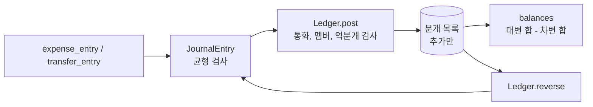

# 설계

## 1단계: 금액·원장 코어 (`app/ledger/`)

DB, 웹, 시계, 난수 없이 표준 라이브러리만 쓰는 순수 파이썬이다. 같은 입력이면 항상 같은 결과가 나온다.
3단계 이후의 DB와 API는 여기서 정한 규칙을 그대로 옮긴다.

### 금액: `Money` (`money.py`)

- `Decimal` 금액 + `Currency`(코드, 소수 자릿수). 불변 값 객체다.
- **float를 받지 않는다.** `Decimal(0.1)`은 `0.1000000000000000055...`이다. 오차가 들어온 뒤에는 되돌릴 수 없으므로 입구에서 막는다.
- **통화 단위보다 작은 값을 만들 수 없다.** 1.5원, 0.001달러는 `InvalidAmountError`. 반올림을 몰래 하지 않는다.
- 다른 통화끼리 더하거나 비교하면 `CurrencyMismatchError`.

다른 방법과 비교:

| 방법 | 장점 | 단점 |
| --- | --- | --- |
| float | 간단 | 이진 오차. 돈에는 쓰면 안 된다 |
| 최소 단위 정수(센트, 원)만 저장 | 빠르고 정확 | 통화마다 자릿수를 따로 기억해야 하고 읽기 어렵다 |
| **Decimal + 통화 자릿수 검증 (선택)** | 정확, 읽기 쉬움, MySQL `DECIMAL`과 그대로 대응 | 정수보다 느리다 (정산 규모에서는 문제없음) |

나누기처럼 내부에서 정수가 편한 계산은 `minor_units`(최소 단위 정수)로 바꿔서 한다.

### 분할: `split.py`

`SplitRule`의 `shares(total) -> {멤버: 금액}`. 결과의 합은 반드시 `total`과 같다.

- `EqualSplit`: 균등
- `RatioSplit`: 정수 비율 (2:1:1, 50:30:20). 가중치 0이면 부담하지 않음
- `FixedSplit`: 직접 입력. 합이 총액과 다르면 거부한다 (차액을 누군가에게 몰래 얹지 않는다)

**나머지 배분: 최대 나머지 방식 (largest remainder)**

1. 최소 단위 정수로 각자 몫을 내림한다: `q, r = divmod(units * w, weight_sum)`
2. 남은 단위를 나머지 `r`이 큰 사람부터 1단위씩 준다.
3. `r`이 같으면 멤버 ID 순서. 입력 순서에 따라 결과가 바뀌지 않게 하려고(결정성).

`r`(정수)로 비교하므로 소수 계산 오차가 없다. 이 방식은 각자의 몫이 정확한 비율 값의 내림 또는 올림이 됨을 보장한다(테스트로 확인).

다른 방법: 남은 1원을 항상 결제자에게, 또는 항상 첫 사람에게 줄 수도 있다. 간단하지만 비율 분할에서 정확한 비율과 더 멀어질 수 있다.

### 원장: `ledger.py`

**이중기입.** 분개(`JournalEntry`)는 차변(`DEBIT`)과 대변(`CREDIT`) 줄로 이루어지고 두 합계가 같아야만 만들어진다.
멤버마다 계정이 하나 있고, 잔액 = 대변 합 - 차변 합이다.

| 거래 | 대변 (받을 돈 +) | 차변 (받을 돈 -) |
| --- | --- | --- |
| A가 30,000원을 내고 A, B, C 균등 | A 30,000 | A 10,000, B 10,000, C 10,000 |
| B가 A에게 10,000원 송금 | B 10,000 | A 10,000 |

모든 분개가 균형이므로 **모든 멤버 잔액의 합은 항상 0**이다. 이 값이 0이 아니면 버그다.

줄 표현: 부호 있는 금액 하나(+대변, -차변)로도 되지만, 금액은 항상 양수로 두고 방향을 `side`로 분리했다.
DB에서 `CHECK (amount > 0)`로 잘못된 값을 막을 수 있고, 회계 용어와 그대로 대응한다.

**추가만 한다 (append-only).** 잘못 기록한 분개는 고치거나 지우지 않고 역분개(`REVERSAL`)를 추가한다.

- 역분개는 원래 분개의 줄을 정확히 뒤집은 것이어야 한다. 아니면 거부한다.
- 한 분개는 한 번만 취소할 수 있고, 역분개 자체는 취소할 수 없다. 다시 필요하면 원래 거래를 새로 기록한다.
- 검사에 실패하면 원장은 바뀌지 않는다.

잔액은 매번 모든 분개를 다시 더해서 구한다. 잔액을 따로 저장하는 방식과의 비교(정합성 vs 조회 속도)는 4단계에서 한다.

### 테스트

- 예시 기반 테스트: 대표 사례와 오류 경로
- property-based 테스트(`hypothesis`): 무작위 입력에서 불변식이 지켜지는지
  - 분할 결과의 합 = 총액, 각자 몫은 정확한 값의 내림 또는 올림, 입력 순서와 무관
  - 무작위 거래·송금·취소 순서 뒤에도 잔액 합 = 0, 모든 분개가 균형
  - 모든 분개를 취소하면 모든 잔액이 0
- CI(`CI` 환경 변수)에서는 hypothesis 시드를 고정한다(`derandomize`). 같은 커밋이면 같은 결과.
